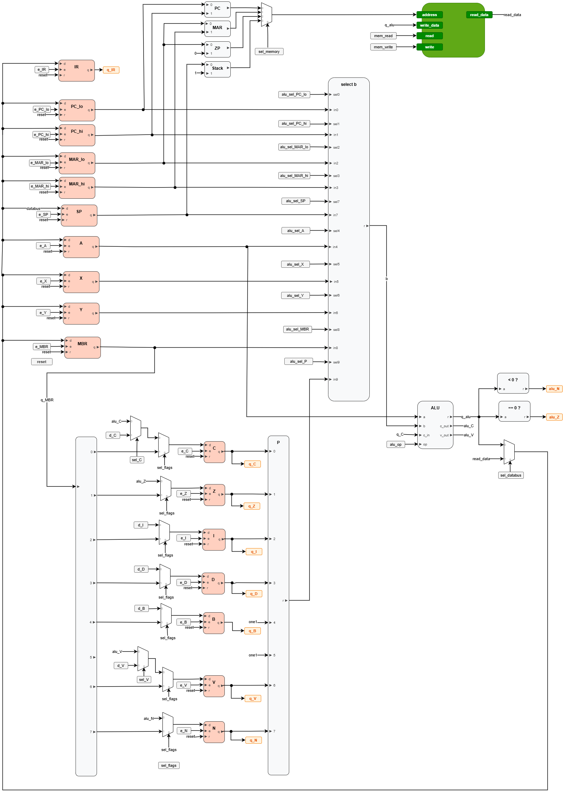

# punxa_6502
A 6502 system emulator in py4hw.
It supports various models in different py4hw design styles.

## Algorithmic single cycle model
An algorithmic model (using coroutines) is used to provide a golden model of the processor that uses a single cycle to
execute the instructions, although it models memory accesses with multiple cycles.

## Structural Datapath Design

The 6502 is also implemented as a multicyle processor.
The datapath is depicted by the following figure.



## Installing Software Compilation Flow
To compile C programs for the 6502 you need the SDCC compiler.

```
svn checkout https://svn.code.sf.net/p/sdcc/code/trunk/sdcc sdcc
cd sdcc
./configure --disable-z80-port --disable-pic14-port --disable-pic16-port --disable-ds390-port --disable-ds400-port  --disable-hc08-port --disable-s08-port --disable-r2k-port --disable-pdk13-port --disable-pdk14-port --disable-pdk15-port --disable-stm8-port --disable-sm83-port --disable-z180-port --disable-f8-port --disable-r2ka-port --disable-r3ka-port --disable-ez80_z80-port --disable-tlcs90-port --disable-r800-port --disable-mcs51-port --disable-z80n-port
make -j 8
sudo make install
```

You can install a disassembler
```
git clone https://github.com/tcarmelveilleux/dcc6502
cd dcc6502
make
```


